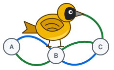

# open-dci

<p align="center">
  
</p>

[](https://github.com/mwindower/open-dci/actions/workflows/ci.yaml)
[](LICENSE)

**Stitch EVPN tenant VRFs across independent EVPN/VXLAN domains using SRv6 L3VPN.**

`open-dci` turns an FRR-based Linux box at the exit of an EVPN fabric, e.g. a
[metal-stack](https://metal-stack.io) partition, into a DCI gateway:
- it provisions the tenant VRFs as EVPN L3VNIs (VRF, bridge, VXLAN device) with the
  tenant's VNI in that partition, so the fabric sees an ordinary VTEP
- the VRFs are exported as VPNv4/v6 with an SRv6 End.DT46 SID
- remote routes come back as EVPN type-5
- each partition keeps its own VNIs, RTs and ASNs

It never rewrites `frr.conf`. It adds its lines via `vtysh` to the gateway's base config
and puts them back whenever the base system reloads its config.

## Why open-dci

Like the weaver bird, which weaves many threads into one nest, open-dci weaves each
tenant's networks from independent fabrics into one.

- **One network per tenant, across all your sites.** Every partition keeps its own EVPN
  fabric, VNIs, route targets and ASNs. open-dci joins a tenant's networks into one routed
  network, IPv4 and IPv6, and keeps tenants apart from each other.
- **No fabric surgery.** The gateways join the fabric like any VTEP. Leaves and spines stay
  as they are, and the network between the sites only needs plain IPv6.
- **Stock Linux and FRR.** No custom data plane, no special hardware: SRv6 in the Linux
  kernel, BGP in FRR, on any server.
- **Fails gracefully, maintains losslessly.** Anycast gateway pairs, dual-attached to two
  exits, with BFD: losing a gateway or an exit costs well under a second. `open-dci drain`
  takes a gateway out without losing a single packet, and a gateway that can't forward
  withdraws itself ([measured](docs/performance.md)).
- **Safe by default.** Prefix allowlists per network, route-target filters and prefix
  limits per peer, no DCI route target in any fabric, and an SRv6 domain closed at its edge.
- **Hands-off.** One YAML file per gateway. open-dci reconciles continuously, survives
  config reloads of the base system and reports its health in `status`, as Prometheus
  metrics and on a health endpoint.

**Use cases**
- A tenant's private networks in several [metal-stack](https://metal-stack.io) partitions
  or datacenters, routed as one.
- Availability zones with independent fabrics and failure domains, connected per tenant.
- Fabrics with different VNI, route-target or ASN plans joined without renumbering, e.g. during a migration.
- Many isolated tenants over one shared IPv6 core.

> [!WARNING]
> **Alpha.** open-dci is at an alpha stage: configuration and behaviour may still change
> incompatibly, and it is not ready for production. It is tested end to end in a
> [containerlab lab](docs/lab.md) that runs in CI.
>
> **L3 stitching only.** Tenant IP prefixes are routed between partitions (EVPN type-5 ↔
> VPNv4/v6). **L2 is not supported**: no stretched subnets, no MAC/IP (type-2) routes, no
> L2VNIs across partitions.

<p align="center">
  
</p>

How a packet travels (per partition, the two exits, the gateway pair and the fabric are one box each):

<p align="center">
  
</p>

Between partitions only IPv6 is needed: exits and core see one locator prefix per gateway,
and nothing of tenants or VNIs. The SRv6 transport runs in one of two modes, which can be
mixed freely:

| Mode | SRv6 transport | Isolation from the fabric | Fits |
|---|---|---|---|
| DCI network (`transport.vrf`), **recommended** | in an EVPN VRF of the base config, over VXLAN through the fabric | by construction: the VRF only exists on gateways and exits | any setup, especially fabrics with untrusted devices in the underlay (e.g. tenant firewalls) |
| Default VRF | in the IPv6 underlay | by configuration: the exits must announce locators only to gateways and core, and filter the edge | gateways with their own routed uplink; no VXLAN overhead (−50 B) and no veth |

## Documentation

**User documentation:** [mwindower.github.io/open-dci](https://mwindower.github.io/open-dci/)
(sources in [`website/docs`](website/docs)).

| | |
|---|---|
| [Introduction](https://mwindower.github.io/open-dci/docs/introduction/what-is-open-dci) | what open-dci is, how it works, design decisions, capabilities and limits |
| [Getting started](https://mwindower.github.io/open-dci/docs/getting-started/requirements) | requirements, installation, quick start, trying it in the lab |
| [Configuration](https://mwindower.github.io/open-dci/docs/configuration/overview) | every field, route targets, networks from metal-apiserver |
| [Operation](https://mwindower.github.io/open-dci/docs/operation/commands) | commands, status, metrics, health and failover, maintenance, the SRv6 domain's edge, adding partitions |
| [metal-stack](https://mwindower.github.io/open-dci/docs/metal-stack/overview) | open-dci in metal-stack |

**Developer documentation:** [`docs/`](docs/README.md): how it works inside, measurements,
the lab and its routing tables, development and roadmap, design history.

Quick look at a gateway (details: [Quick start](https://mwindower.github.io/open-dci/docs/getting-started/quick-start)):

```sh
open-dci validate -c /etc/open-dci/config.yaml   # check the config
open-dci render   -c /etc/open-dci/config.yaml   # the FRR lines it will add
open-dci run      -c /etc/open-dci/config.yaml   # reconcile continuously
open-dci status   -c /etc/open-dci/config.yaml
```

## License

[MIT](LICENSE)
